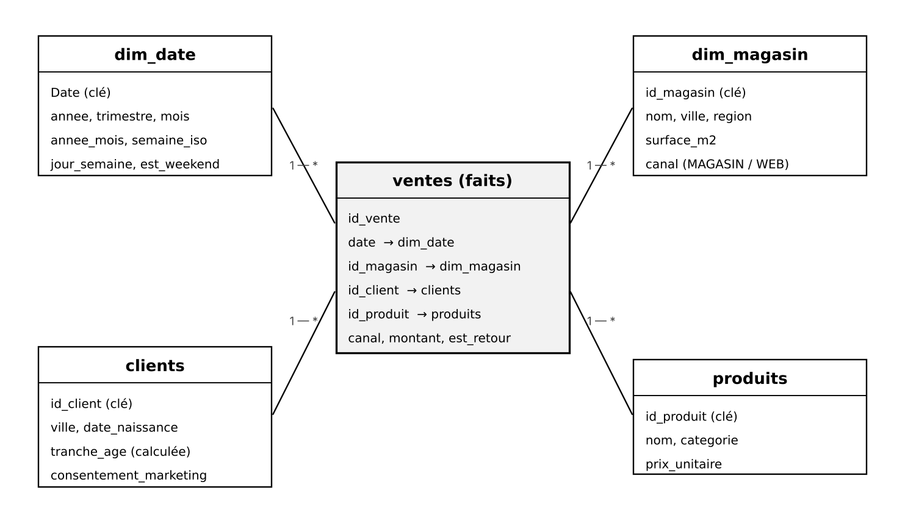
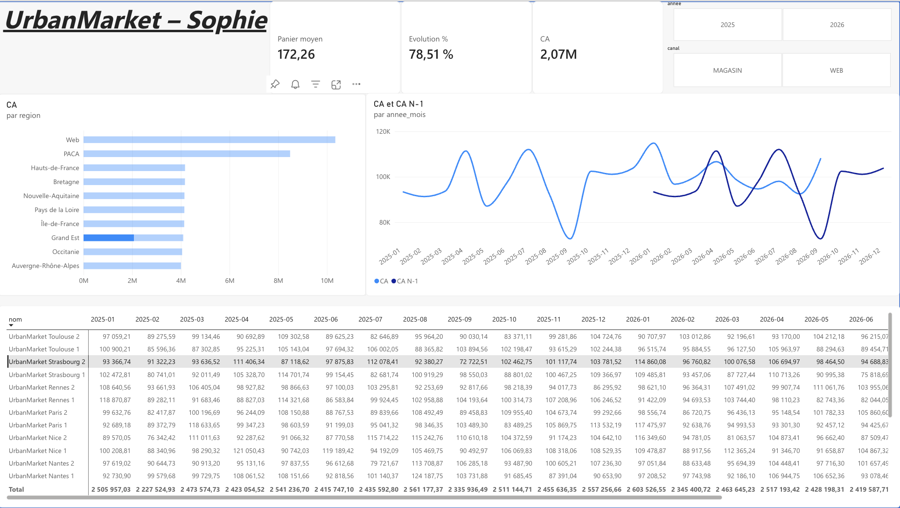

# DATE731 – Data lake UrbanMarket

Travaux pratiques du module **DATE731 – Architecture Data Lake et plateformes décisionnelles** (EPSI, Bloc 3).

Réalisé par **Bouchra Rahil ADLAOUI** et **Nour BOUYANFIF** – Enseignant : Ali ZAHAF – Novembre 2026.

## Le projet

UrbanMarket est une enseigne de distribution qui possède des magasins physiques et un site web. Nous avons construit son data lake en trois zones (architecture « médaillon ») sur **Databricks Free Edition**, puis un tableau de bord dans **Power BI** pour Sophie, la directrice commerciale.

```
Sources (CSV, JSON)  →  BRONZE (copie exacte)  →  SILVER (nettoyé, Delta)  →  Power BI (modèle en étoile)
```

| Zone | Contenu dans Databricks | Règle |
| --- | --- | --- |
| Bronze | Volume `workspace.bronze.fichiers`, rangé par `source/entité/ingestion_date=AAAA-MM-JJ/` + manifestes | On ne modifie jamais |
| Silver | Tables Delta `workspace.silver.*` (ventes, clients, produits, magasins, stocks, logs_web) + quarantaine et journal des contrôles | Chaque contrôle est écrit |
| Gold | Modèle en étoile (construit dans Power BI pour le TP3) | Prêt pour l'analyse |

## Contenu du dépôt

| Dossier / fichier | Rôle |
| --- | --- |
| `notebooks/TP1_01_creer_zones_et_bronze.py` | Crée les schémas bronze, silver, gold, génère les données (graine 731) et les dépose en bronze |
| `notebooks/TP1_02_profiler.py` | Profil des fichiers bronze : volumes, valeurs manquantes, doublons, anomalies |
| `notebooks/TP1_03_bronze_vers_silver.py` | Règles de nettoyage (V1–V7, C1–C5, P1, S1–S2, L1–L2), écriture des tables silver et de la quarantaine |
| `notebooks/TP2_banc_essai.py` | Banc d'essai : formats (CSV, JSON, Parquet, Delta), partitionnement, petits fichiers, fonctions Delta |
| `notebooks/TP3_export_silver_powerbi.py` | Export des tables silver vers Excel pour Power BI (sans noms ni e-mails clients) |
| `notebooks/TP3_modele_etoile.py` | Variante : modèle en étoile construit directement en gold dans Databricks |
| `docs/` | Les trois rapports en Word et en PDF (lisibles directement sur GitHub) et les captures |
| `scripts/`, `catalogue.yaml`, `requirements.txt` | Kit fourni par l'enseignant |

Les fichiers `.py` du dossier `notebooks/` sont des notebooks Databricks : dans Databricks, **Espace de travail → Importer** pour les ouvrir.

## Les rapports

| TP | Lire en ligne (PDF) | Télécharger (Word) |
| --- | --- | --- |
| TP1 – Matrice usages, exigences, composants | [PDF](docs/TP1_matrice_usages_exigences_composants.pdf) | [Word](docs/TP1_matrice_usages_exigences_composants.docx) |
| TP2 – Banc d'essai formats et partitionnement | [PDF](docs/TP2_banc_essai_formats_partitionnement.pdf) | [Word](docs/TP2_banc_essai_formats_partitionnement.docx) |
| TP3 – Modèle en étoile et tableau de bord | [PDF](docs/TP3_modele_etoile_tableau_de_bord.pdf) | [Word](docs/TP3_modele_etoile_tableau_de_bord.docx) |

## Résultats principaux

**TP1 – Zones et silver.** 6 sources ingérées en bronze avec manifeste ; règles de qualité appliquées en silver, lignes rejetées conservées en quarantaine avec leur motif.

**TP2 – Formats et partitionnement** (300 000 ventes) :

| Format | Taille | Requête |
| --- | --- | --- |
| CSV | 28,05 Mo | 1,27 s |
| Parquet zstd | 5,12 Mo | 0,68 s |
| Delta | 4,33 Mo | 0,42 s |

Le partitionnement par magasin et par jour crée 13 398 petits fichiers et rend la requête 180 fois plus lente : à notre volumétrie, on ne partitionne pas. Choix retenu : **Delta + zstd** en silver et en gold, avec OPTIMIZE régulier.

**TP3 – Tableau de bord de Sophie** : modèle en étoile (ventes + dim_date, dim_magasin, clients, produits) et mesures DAX CA, CA N-1, Evolution %, Panier moyen.





- Le web représente 20 % du chiffre d'affaires.
- L'activité est stable : +1,3 % au premier semestre 2026 par rapport à 2025.
- Nice recule de 8 % en mars 2026 (l'énoncé annonçait +14 % : écart dû au jeu de données généré).

## Limites

- Databricks Free Edition bloque l'accès à un compte de stockage Azure (ADLS Gen2) : tout le lake est stocké dans Databricks. En production, les zones seraient sur ADLS Gen2.
- Power BI ne peut pas se connecter directement à la Free Edition : les données passent par un export Excel, actualisé à la main.

## Sécurité

Le fichier `.env` (clés et mots de passe) n'est **jamais** envoyé sur GitHub : il est exclu par `.gitignore`. Seul le modèle `.env.exemple`, sans valeurs, est publié.
